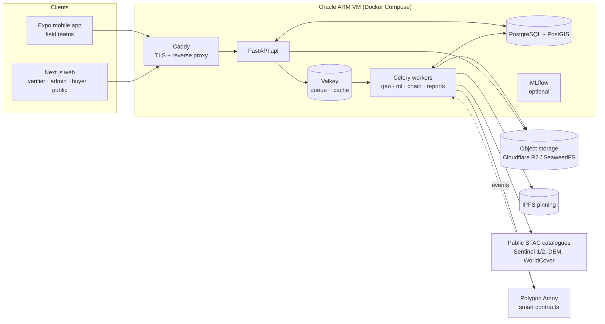
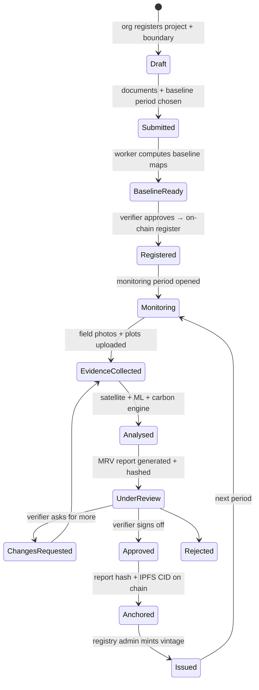

# AquaCreds v2 — Implementation Plan

> Blockchain-based Blue Carbon Registry and MRV system (SIH25038, team VISSDOM), rebuilt from scratch as a
> production-grade MVP with a strong, honest ML core.
>
> Status: **planning, revision 2** (re-verified against BM FR05.001 / AR-TOOL14) · Last updated: 2026-10-19
>
> Companion documents:
> - [TECH_STACK.md](TECH_STACK.md): every technology choice, the alternatives considered, and why.
> - [DATASETS.md](DATASETS.md): every dataset, where it comes from, licence, and how it is used.
> - [RESEARCH_NOTES.md](RESEARCH_NOTES.md): answers on land tenure, satellite timing, monitoring
>   duration and the carbon calculation, plus the plan changes R1–R9 they forced (already applied
>   below; revision 2).
> - [CONTEXT.md](CONTEXT.md): project memory (what exists, decisions made, what is next).
> - [../requirements/](../requirements/): installable requirement files and setup prerequisites.

---

## 1. Goals and non-goals

### Goals
1. **End-to-end working MRV flow** with no mocked steps. Each step runs for real: register a project with a
   real boundary, capture field evidence, run satellite and ML analysis, apply a carbon engine, get verifier
   approval, anchor on-chain, issue credits, trade, and retire.
2. **Scientifically defensible ML.** Train on real public datasets, use spatial validation, report metrics
   honestly, attach uncertainty to every number, and publish a model card for every model.
3. **Production-grade engineering.** Typed APIs, migrations, tests, CI/CD, containerised services,
   observability, backups, and a security review.
4. **Free to run.** Deploy on an Oracle Cloud Always Free ARM VM with Docker Compose, use the Polygon Amoy
   testnet, and use free data sources.
5. **Mobile app plus web dashboard.** Expo for field teams; Next.js for verifiers, admins, buyers and the
   public registry.

### Non-goals (for the MVP)
- Issuing legally recognised carbon credits. Tokens are **testnet registry units** that mirror what a real
  programme would issue. Official issuance needs CCTS/Verra accreditation (see §11).
- Polygon mainnet, real money, or fiat payment gateways.
- Production-quality seagrass carbon accounting (see §6.6; there is no reliable free method for turbid
  Indian waters yet). Seagrass and salt marsh are *mapped*; only mangroves are *credited* in v2.0.

---

## 2. Lessons from the legacy prototype

The SIH 2025 prototype (`_legacy/aquacreds-system`, git-ignored and kept for reference only) proved the UX
idea, but its core pipeline was not real. The v2 plan exists to fix each of these:

| Area | Legacy behaviour | v2 fix |
|---|---|---|
| Training data | ~38 hand-typed rows of band values | Thousands of labelled points from coastTrain, GMW and WorldCover, with features extracted from real Sentinel imagery (§6) |
| Model metrics | `model.py` printed a hard-coded 92% accuracy | Metrics computed automatically, with spatial cross-validation and a geographically held-out test region, logged in MLflow |
| Biomass | NDVI×100 → canopy → fake DBH → per-tree Komiyama equation without wood density, reported as t/ha | AGB regression on GEDI/CCI reference biomass plus canopy height; Komiyama used correctly (with wood density) only for field plots (§6.4) |
| Spatial unit | Mean over a whole 100×100 km Sentinel tile | Pixel-level analysis clipped to the registered project polygon |
| Reflectance | Raw digital numbers, so EVI > 1 | L2A surface reflectance scaled correctly (with the processing-baseline offset), plus a cloud/shadow mask |
| Backend ↔ ML | Never connected; "analysis" guessed from the filename; MRV used `random.uniform` | Worker runs the real pipeline; every MRV record stores model versions and input scene IDs |
| Blockchain | Called a non-existent `CarbonRegistry` contract and silently stored fake `DEMO_TX_` hashes; mint endpoint had no auth | Contracts with role-based access control and tests; a transaction is "confirmed" only when a receipt exists; failures surface as errors |
| IPFS | Stub returned fake CIDs | Real pinning of evidence bundles |
| Mobile photo | Saved locally, never uploaded | In-app capture → offline queue → upload → server-side checks |
| Credits | Stock × area, minted once per project | Credits come from **verified change** per monitoring period under a configured methodology, with buffer and uncertainty deductions |

---

## 3. System overview



### Core domain flow (state machine)



A **project** has many **monitoring periods**. Each period produces one **MRV report**, and each approved
report can produce **one credit vintage** (an ERC-1155 token ID). This replaces the legacy "mint once per
project" model.

---

## 4. Repository structure (target)

```
Aquacreds_final/
├── apps/
│   ├── web/                 # Next.js 16 dashboard + public registry
│   └── mobile/              # Expo SDK 58 field app
├── services/
│   ├── api/                 # FastAPI (HTTP only, no heavy compute)
│   └── worker/              # Celery tasks: geo, ml, chain, reports
├── packages/
│   ├── aqua_core/           # shared Python: settings, db models, schemas
│   ├── aqua_geo/            # STAC search, compositing, feature stacks, zonal stats
│   ├── aqua_carbon/         # deterministic carbon engine (pure Python, 100% unit-tested)
│   └── api-client/          # TS client generated from OpenAPI (used by web + mobile)
├── ml/
│   ├── pipelines/           # DVC stages: labels → features → train → evaluate → export
│   ├── notebooks/           # exploration only, never the source of truth
│   ├── configs/             # YAML experiment configs
│   └── model_cards/         # one markdown card per released model
├── contracts/               # Foundry project (Solidity + tests + deploy scripts)
├── infra/
│   ├── compose/             # docker-compose.{dev,prod}.yml, Caddyfile
│   ├── docker/              # Dockerfiles (multi-stage, multi-arch)
│   └── scripts/             # backup, restore, deploy, bootstrap-vm
├── data/                    # DVC-tracked (raw/interim/processed) — not in git
├── docs/                    # this plan, stack, datasets, context, ADRs, runbooks
├── requirements/            # shareable requirement files + prerequisites
├── .github/workflows/       # CI/CD
├── dvc.yaml · pyproject.toml (uv workspace) · pnpm-workspace.yaml · turbo.json
└── README.md · CLAUDE.md
```

---

## 5. Phase plan

Effort is given in **focused weeks for 2–3 developers**. Phases 1 (ML research) and 2 (core backend) run
**in parallel**; they meet in Phase 4.

| # | Phase | Effort | Depends on |
|---|---|---|---|
| 0 | Foundations: repo, tooling, Compose, CI | 1 wk | — |
| 1 | Data acquisition + ML research track | 4–5 wk | 0 |
| 2 | Core backend + domain model | 2–3 wk | 0 |
| 3 | Field capture (mobile) + evidence checks | 2–3 wk | 2 |
| 4 | Satellite pipeline + ML inference in production | 2–3 wk | 1, 2 |
| 5 | Carbon engine, MRV reports, verifier dashboard | 2–3 wk | 4 |
| 6 | Blockchain: contracts, relayer, indexer, IPFS | 2–3 wk | 2 (can start early) |
| 7 | Marketplace, forward funding (reverse auction), loyalty | 2 wk | 6 |
| 8 | Public transparency registry | 1 wk | 5, 6 |
| 9 | Hardening + free deployment | 1–2 wk | all |
| 10 | Pilot sites, evaluation, documentation | 1–2 wk | 9 |

Total: about **18–24 weeks** sequentially, or **12–14 weeks** with the parallel tracks.

---

### Phase 0 — Foundations (1 week)

**Tasks**
- Monorepo: `uv` workspace for Python (3.12), `pnpm` + Turborepo for TypeScript.
- Code quality: `ruff`, `mypy`, `pytest`; ESLint/Prettier/`tsc`; `pre-commit` with gitleaks.
- `infra/compose/docker-compose.dev.yml` with api, worker, postgis, valkey, seaweedfs (S3), and optional
  mlflow. Use healthchecks and named volumes.
- Multi-stage, multi-arch Dockerfiles (`linux/amd64` + `linux/arm64`, because Oracle Always Free is ARM).
- GitHub Actions: lint + test on PR with path filters; build and push images to GHCR on `main`.
- Write `.env.example`, `docs/adr/` (architecture decision records), and the Makefile/justfile tasks
  `dev`, `test`, `lint`, `migrate`, `seed`.

**Exit criteria:** `docker compose up` gives a healthy `/healthz` on the API, a worker that processes a
ping task, and green CI.

---

### Phase 1 — Data acquisition + ML research (4–5 weeks, parallel)

This is the most important phase. Full dataset details are in [DATASETS.md](DATASETS.md).

**1a. Data infrastructure**
- Set up DVC with a Cloudflare R2 remote (10 GB free). Every raw download is a reproducible DVC stage with
  a pinned URL and checksum.
- Define the **area of interest (AOI)**: India's coastline (all mangrove states plus the Andaman & Nicobar
  Islands), with a 10 km land/sea buffer. Optionally add Sri Lanka and Bangladesh for more training
  diversity.
- Build a **spatial grid**: H3 resolution 5 cells (about 250 km²), used for spatial cross-validation groups.

**1b. Labels**
- **Ecosystem classes (v2.0):** `mangrove`, `salt_marsh`, `tidal_flat`, `water`, `terrestrial_vegetation`,
  `cropland_aquaculture`, `built_bare`. Seagrass is a research class (§6.6).
- Sources:
  - coastTrain points (mangrove, saltmarsh, tidal flat).
  - Stratified random samples inside Global Mangrove Watch 2020 mangrove polygons, eroded 30 m inward to
    avoid mixed edge pixels.
  - Worthington et al. 2024 tidal marsh map.
  - ESA WorldCover 2021 for the non-target classes.
- Clean the labels:
  - Drop points where sources disagree.
  - Remove near-duplicates within 50 m.
  - Cap points per H3 cell so the Sundarbans doesn't dominate.
- Manually QA about 500 points on high-resolution imagery, using Google Earth / Esri World Imagery
  basemaps viewed in QGIS. This becomes the **gold test set**.

**1c. Features (shared by training and production; code lives in `packages/aqua_geo`)**
- **Sentinel-2 L2A**, years 2020–2025:
  - Mask clouds, shadows and cirrus with the SCL layer.
  - Apply the harmonised reflectance scaling (BOA offset for processing baseline ≥ 04.00).
  - Build composites: dry-season median (Nov–Mar), plus annual 10th/50th/90th percentiles.
  - Bands: B2, B3, B4, B5, B6, B7, B8, B8A, B11, B12.
- **Indices:** NDVI, EVI, SAVI, NDWI (McFeeters, *green–NIR*, documented explicitly), MNDWI, NDMI, MVI
  (Mangrove Vegetation Index), CMRI (Combined Mangrove Recognition Index), red-edge NDRE.
- **Sentinel-1 RTC:** VV and VH median, VH/VV ratio, and temporal standard deviation. These capture tidal
  inundation dynamics and fill monsoon cloud gaps.
- **Terrain:** Copernicus DEM GLO-30 elevation and slope. Mangroves sit near mean sea level.
- **Canopy height:** ETH Global Canopy Height 2020 (10 m). Optionally Meta/WRI 1 m canopy height,
  aggregated to 10 m.
- **Foundation-model embeddings (experiment arm):** Google AlphaEarth *Satellite Embedding V1*, 64-d,
  annual, 10 m, CC-BY 4.0, readable as COGs from GCS/AWS without Earth Engine.

**1d. Model A — ecosystem classifier (pixel level)**

| Candidate | Why it's included |
|---|---|
| Random Forest (scikit-learn) | **Baseline**, the model named in the original proposal. Re-implemented honestly. |
| LightGBM | Usually beats RF on tabular remote-sensing features; fast on CPU/ARM; native categorical handling. |
| XGBoost | Second gradient-boosting reference. |
| AlphaEarth embeddings + LightGBM/logistic regression | Foundation-model features; often strongest with few labels. |
| U-Net (segmentation_models_pytorch, pretrained encoder) on 256×256 chips | Uses spatial context; this is the "U-Net" from the PPT. Stretch goal; trained on Kaggle/Colab GPU. |

- **Validation:**
  - Spatial group k-fold (H3 groups).
  - A **geographically held-out region**: train without the Gulf of Kutch (Gujarat), then test there. This
    measures generalisation to a new coast.
  - The gold test set.
- **Metrics:** per-class precision/recall/F1, macro-F1, overall accuracy, and confusion matrix. **Area
  estimates use the Olofsson et al. (2014) good-practice method:** error-adjusted area with a 95%
  confidence interval, which is the standard for carbon/REDD+ area reporting.
- **Selection rule:** highest macro-F1 on the held-out region. Ties go to the simpler/faster model. All runs
  are logged to MLflow with config, data version (DVC hash), and git SHA.

**1e. Model B — above-ground biomass (AGB) regression**
- **Reference labels:**
  - GEDI L4A footprint AGBD (v2.1, quality-filtered: `l4_quality_flag == 1`, degrade flag 0, leaf-on,
    within the GMW mask). Pulled with `earthaccess` (free NASA Earthdata login).
  - ESA CCI Biomass maps as a secondary reference.
  - Simard et al. 2019 (nominal year 2000) for **comparison only**.
- **Role in crediting (R2):** this model's output is the **auxiliary variable** for model-assisted
  (double-sampling) estimation against field plots, and the basis for stratification. It is never used
  on its own for issuance.
- **Independent validation:** a table of published Indian mangrove field-plot AGB values compiled from the
  literature (Sundarbans, Bhitarkanika, Pichavaram, etc., with coordinates and year), plus plots from pilot
  partners later.
- **Candidates:**
  - RF regression (baseline).
  - LightGBM with quantile objectives (P10/P50/P90).
  - XGBoost.
  - LightGBM on AlphaEarth embeddings plus canopy height.
- **Uncertainty:** conformalised quantile regression (MAPIE) for calibrated per-pixel intervals. Project
  totals are aggregated with spatially correlated error, so pixel errors are not assumed independent (see
  §6.5).
- **Metrics:** RMSE, MAE, bias, R², and interval coverage (a 90% interval should cover ~90% of held-out
  points). Compare against Simard and CCI at the same pixels.
- **Known limitation, documented in the model card:** GEDI has larger errors over dense mangrove, and
  footprints are sparse. Because of that, AGB maps are an *estimate with uncertainty*, not a measurement.
  Field plots remain the gold standard.

**1f. Model C — field-photo verifier.** Full rationale is in [TECH_STACK.md §ML](TECH_STACK.md#5-machine-learning).
- **Task:** decide whether the photo shows mangrove/coastal wetland vegetation (and which genus, if
  possible), and whether it's a plausible live capture.
- **Data:** research-grade iNaturalist observations via a GBIF download, licence-filtered to
  CC0/CC-BY/CC-BY-NC. Positives are Indian mangrove genera (*Rhizophora, Avicennia, Sonneratia,
  Bruguiera, Ceriops, Excoecaria, Heritiera, Kandelia, Aegiceras, Lumnitzera, Xylocarpus*). Negatives are
  other coastal/terrestrial vegetation, beaches, mudflats without vegetation, plantations, indoor scenes,
  and screens.
- **Candidates:**
  1. MobileNetV2 fine-tuned (**baseline**, the legacy architecture).
  2. MobileNetV4 / EfficientNetV2-S fine-tuned (timm).
  3. BioCLIP 2 zero-shot, using genus names as text prompts (needs no training data).
  4. BioCLIP 2 or DINOv2 frozen embeddings + logistic-regression head (few-shot).
- **Deployment:** export the winner to ONNX and run it with onnxruntime on CPU in the worker. If ViT-L
  latency on ARM is too high (target < 3 s per photo), distil it into MobileNetV4 using pseudo-labels from
  the large model.
- **Metrics:** F1, AUROC, false-accept rate at 95% recall, and calibration (ECE).

**1g. Exports.** The selected models are exported (LightGBM text/ONNX, image model ONNX), with a model
card, versioned via DVC, and uploaded to object storage. The worker loads them **by version**, and that
version is recorded in every MRV record.

**Exit criteria:**
- Reproducible `dvc repro` from raw data to metrics.
- Model cards published.
- Held-out results documented, whatever the numbers turn out to be.

---

### Phase 2 — Core backend + domain model (2–3 weeks, parallel)

**Tasks**
- **FastAPI layout:** `routers/`, `services/`, `repositories/`, `schemas/`. Async SQLAlchemy 2 +
  GeoAlchemy2. Migrations with Alembic.
- **Auth:**
  - Email/password (Argon2id), short-lived JWT access tokens plus rotating refresh tokens stored hashed.
  - Email verification and password reset (free SMTP: Brevo or Resend free tier).
  - Optional SIWE (Sign-In With Ethereum) to link a wallet.
- **RBAC roles:** `field_agent`, `org_admin`, `verifier`, `registry_admin`, `buyer`, `public`. Policies are
  enforced in dependencies **and** tested.
- **Entities:** Organisation (NGO / panchayat / company) → Users; Project (boundary `MULTIPOLYGON` SRID
  4326, ecosystem, methodology, land-tenure documents); MonitoringPeriod; FieldSubmission (photo, GPS,
  accuracy, device info, server timestamp); PlotMeasurement (tree DBH/height/species); AnalysisRun;
  MRVReport; ChainTransaction; CreditVintage; Listing; Order; Retirement; AuditLog.
- **Boundary validation:**
  - Valid geometry, area limits (MVP max 5,000 ha per project).
  - Overlap check against other registered projects using PostGIS `ST_Intersects`. This prevents
    **double counting**.
  - Must intersect the coastal AOI.
- **Uploads:** pre-signed S3 PUT URLs (the client uploads directly), with size/MIME limits and a checksum
  confirmed by the API.
- **Append-only audit log:** each entry stores a SHA-256 of the previous entry (a hash chain), so tampering
  with history is detectable even before anything is anchored on-chain.
- **OpenAPI → `packages/api-client`** (TypeScript via openapi-typescript + openapi-fetch), regenerated in
  CI. A drift check fails the build if the client is stale.
- **Rate limiting** (slowapi + Valkey), a CORS allowlist, and structured logs (structlog JSON).

- **Tenure & authorisation evidence pack (R5).** This replaces the PPT's "land registry check", since
  intertidal land has no ordinary registry. Each project declares a tenure type (`forest_land`,
  `revenue_government_land`, `port_or_central_land`, `community_panchayat`, `private_land`) and uploads
  the matching documents: Forest Department MoU, Collector NOC, Panchayat resolution + FPIC record, title
  + consent, CRZ/CZMA clearance, and a carbon-rights/benefit-sharing agreement. Documents are private;
  hashes are anchored. A verifier tenure checklist is required before registration. Details are in
  RESEARCH_NOTES Q1.
- **CCTS eligibility validation (R8):**
  - Project start ≥ 2025-01-01.
  - Declared mangrove-species share > 90%.
  - Soil disturbance ≤ 10% (declared + evidenced).
  - A "degraded mangrove habitat" signal from GMW 1996–2020 history (computed in Phase 4).

**Exit criteria:** integration tests (pytest + testcontainers PostGIS) cover auth, RBAC, the project
lifecycle and the overlap check; coverage ≥ 80% on services.

---

### Phase 3 — Field capture (mobile) + evidence checks (2–3 weeks)

**Mobile (Expo SDK 58, expo-router, TypeScript)**
- Role-based navigation, re-implementing the legacy screens on the new API client.
- **In-app camera only** (`expo-camera`); gallery picks are disabled for evidence. At capture time, record:
  GPS fix and reported accuracy (`expo-location`, high accuracy), heading, device model, app version, and
  a server-issued **capture nonce** fetched before the shot (proves the photo is recent).
- **Offline-first.** Coastal sites often have no signal. Submissions queue in `expo-sqlite`, upload with
  retry/backoff, and show sync status.
- **Boundary capture:** walk the perimeter (GPS track) or import KML/GeoJSON; preview on a map
  (MapLibre React Native).
- **Sample-plot inventory (mandatory for crediting, R1).** AR-TOOL14 requires ex-post biomass from
  sample plots, so the app must support:
  - **Plot design and allocation:** permanent circular/square plots, stratified by Phase 4 strata, with
    a **sample-size calculator** targeting ±10% at 90% CI.
  - **Navigation** to pre-allocated plot centres.
  - **GPS averaging** (30–60 s) at plot centres.
  - **Plot-centre photo** showing the physical marker/tag ID.
  - **Per-tree records:** species (Indian mangrove list), DBH, height, alive/dead; seedling counts for
    young plots.
  - **Re-measurement** of the same plots at each verification.
- **Fixed photo-monitoring points (R7):** re-photographed every ~6 months at the same bearing. This is
  "participatory photo-mapping" evidence that crown cover has not decreased (AR-TOOL14 ¶26).
- **Tide awareness (R7):** predicted tide height is stored with each capture; crews are guided to
  low-tide windows.
- **i18n:** English + Hindi to start; Bengali, Odia, Tamil, Gujarati and Marathi are planned (coastal
  states).

**Server-side evidence checks (worker `ml` queue)**
1. **EXIF + device metadata** extraction. Mismatch between EXIF GPS/time and app-reported GPS/time → flag.
2. **Nonce + timestamp window:** the capture nonce must be valid and used within N minutes of issue.
3. **Geofence:** the point must be inside the project boundary (with a GPS-accuracy buffer).
4. **Duplicate / near-duplicate detection:** perceptual hash (pHash) compared against *all* previous
   uploads platform-wide. This catches reused photos across projects.
5. **Photo verifier model** (Model C): vegetation-class probability and genus guess.
6. **Satellite consistency:** at the photo location, the Model A mangrove probability and NDVI time series
   must be consistent with the claim.

Each check yields `pass | warn | fail` with a reason. The combination produces an **evidence trust score**
that the verifier sees. Nothing is auto-rejected without human review, except hard failures (outside the
boundary, or an exact duplicate).

**Exit criteria:** on a test device, an offline capture syncs when back online, all six checks run, and
results appear in the API.

---

### Phase 4 — Satellite pipeline + ML inference in production (2–3 weeks)

**Worker `geo` queue tasks**
1. `build_feature_stack(project, period)`:
   - Search STAC (Planetary Computer, falling back to Earth Search) for S2/S1 scenes that intersect the
     boundary.
   - Load them clipped to the polygon with `odc-stac` (dask-chunked, 10 m, local UTM CRS).
   - Mask, composite, and compute indices, using the **same code** as training.
   - Cache as a COG in object storage.
2. `classify(project, period)`: Model A → class map (COG) + class probabilities.
3. `estimate_agb(project, period)`: Model B → AGB P10/P50/P90 rasters, restricted to mangrove pixels.
4. `zonal_stats`: area per class (with Olofsson-style CI from the model's confusion matrix), AGB totals
   with intervals, mean NDVI, and the inter-period change.
5. Provenance: every output stores the STAC item IDs, model versions, code version, and parameters.

**Processing schedule (R6), so nothing takes days:**
- Reads are COG windowed reads of the project polygon only; whole tiles are never downloaded.
- **At registration:** one backfill job, 2017 → today (~500–700 S2 scenes + S1, tens of minutes).
- **Nightly (Celery beat):** fetch only new scenes per active project, append per-scene zonal statistics
  to a Postgres time-series table, and raise **loss/degradation alerts** against the project's own
  historical envelope.
- **Seasonally (dry season) / annually:** composites, then classifier + biomass model.
- Monitoring cadence: photo points every 6 months; internal monitoring report annually;
  **verification + issuance every 2–5 years, first at year 3–5**. Credits are ex-post only. See
  RESEARCH_NOTES Q2–Q3.

**Operational constraints for the free VM:** one `geo` worker with concurrency 1, a memory cap via Compose
`mem_limit`, dask chunk sizing, and a per-project area cap. A 5,000 ha project at 10 m is about 500k
pixels per scene, which is comfortable.

**Exit criteria:** submitting a real polygon (e.g. part of Bhitarkanika) produces maps and statistics in
under 10 minutes on the target VM spec.

---

### Phase 5 — Carbon engine, MRV reports, verifier dashboard (2–3 weeks)

**`packages/aqua_carbon`: a deterministic, methodology-configurable engine** (details in §6.4–6.5)
- Inputs: baseline-period stats, monitoring-period stats, field plots, methodology config (YAML), and
  uncertainty inputs.
- Outputs: carbon stock by pool (AGB, BGB, optional soil), **stock change**, gross removals, deductions
  (uncertainty, leakage, non-permanence buffer), and **net estimated removals (tCO₂e)** with a full
  calculation trace.
- **Primary profile `ccts_bm_fr05_001` (R3)** implements BM FR05.001 Eq. 1–8 exactly:
  - ΔC_BSL, ΔC_ACTUAL = ΔC_P − GHG_E, LK, ΔC_AR.
  - **tCCC / lCCC** per verification period.
  - AR-TOOL14 plot-based stocks with the **uncertainty-discount table** (U ≤ 10% → 0; 10–15% → 25%;
    15–20% → 50%; 20–30% → 75%; > 30% → 100% of U).
  - CF = 0.47 by default.
  - SOC default 0.50 t C/ha/yr for 20 years after planting.
  - Model-assisted (double-sampling) estimation, using satellite AGB as the auxiliary variable to
    tighten plot-based uncertainty.
- Methodology profiles: `ccts_bm_fr05_001` (India CCTS, mangrove A/R) and `vm0033_v2_1` (Verra) as
  configuration plus documentation. They mirror the structure of each methodology, but **do not claim
  compliance** until reviewed by an accredited verifier.
- 100% unit-test coverage, including golden-file tests with hand-calculated examples.

**MRV report**
- A JSON canonical record (RFC 8785 JSON Canonicalization Scheme), plus PDF (WeasyPrint HTML templates),
  CSV, and GeoJSON exports.
- `report_hash = SHA-256(JCS(record))`. The evidence bundle is a manifest of photo hashes, raster hashes,
  STAC IDs and model versions. Raw photos are **not** put on IPFS, because geotagged photos of people are
  personal data.

**Web dashboard (Next.js) for verifiers and admins**
- A project map: boundary, class map, AGB map, photo pins coloured by trust score, and a before/after
  swipe slider between periods.
- Evidence panel showing each check's result; a plot-measurement table; calculation trace.
- Actions: approve, request changes (with comments), reject. All actions are written to the audit log.
- Admin: organisations, users/roles, verifier assignment (with a conflict-of-interest check), issuance
  queue.

**Exit criteria:** a verifier can review a fully analysed monitoring period end to end and approve it,
producing a hashed report.

---

### Phase 6 — Blockchain layer (2–3 weeks; can start after Phase 2)

**Contracts (Foundry, Solidity 0.8.x, OpenZeppelin Contracts 5.x)**

| Contract | Responsibility |
|---|---|
| `AquaRegistry` | `AccessControl` roles (`REGISTRAR`, `VERIFIER`, `ISSUER`, `PAUSER`). Registers a project (ID, boundary hash, metadata CID, owner). Records monitoring reports (report hash, evidence CID, period, approved net tCO₂e) with verifier signatures. Pausable. |
| `AquaCredit` (ERC-1155) | One token ID per **project × verification period × credit type (tCCC / lCCC, R4)**, with an expiry timestamp. When a later verification shows a reversal (lCCC < 0), the issuer's **replacement obligation** is recorded on-chain and must be settled (retire equivalent units) before new issuance. `mint` only by `ISSUER`, capped at the approved net tCO₂e for that report (prevents over-issuance). `retire(id, amount, beneficiary, reason)` burns tokens and emits a certificate event. Optional transfer restriction to KYC'd accounts (allowlist), switched off by default. |
| `AquaProject` (ERC-721, soulbound) | Optional project "deed" NFT (the PPT's "NFT for unique plantation records"), non-transferable. |
| `AquaMarketplace` | Fixed-price listings of ERC-1155 credits for an ERC-20 payment token (test USDC / mock stablecoin on Amoy). Pull-payment pattern, `ReentrancyGuard`, fee in basis points. |
| `AquaForwardFund` | Reverse-auction forward funding (§Phase 7). |

**Tooling and safety**
- Unit tests + fuzz tests + invariant tests (e.g. total minted ≤ total approved).
- Slither in CI.
- Gas snapshots.
- Deploy scripts with `forge script` to Anvil (local) and Amoy (testnet).
- Source verification on Polygonscan.

**Backend chain integration (worker `chain` queue, concurrency 1)**
- **Relayer:** the platform signs transactions for custodial organisation wallets.
  - One HD-derived address per organisation; the master key is held in a Docker secret, never in a
    database.
  - Managed nonce, gas estimation with a cap, retries, and confirmation tracking. A transaction is only
    marked `confirmed` after N blocks.
  - Buyers and admins use their own MetaMask through wagmi/viem.
- **Indexer:** polls contract events and upserts them into Postgres, making the chain the source of truth
  for balances. Alternatives are in TECH_STACK.md.
- **IPFS pinning** of the report JSON, PDF and evidence manifest (Pinata free tier, or self-hosted Kubo).
- RPC via a free-tier provider (Alchemy/Infura/QuickNode), because the Polygon public Amoy RPC was
  scheduled for shutdown in July 2026.

**Exit criteria:**
- On Amoy, a full flow (register → report → approve → mint → list → buy → retire) works with real
  transaction hashes visible on Polygonscan.
- Contract tests cover ≥ 95% of lines.

---

### Phase 7 — Marketplace, forward funding (reverse auction), loyalty (2 weeks)

- **Marketplace UI:** browse vintages with project evidence (map, report, trust score), buy with MetaMask,
  and retire from the portfolio, which generates a **retirement certificate** (PDF + QR code linking to the
  public page).
- **Forward funding via reverse auction** (defined precisely, since the PPT left it open):
  1. A *buyer* posts a request: quantity of future tCO₂e, maximum price, delivery window, and escrows funds
     in the payment token.
  2. *Registered projects* submit offers (price per tCO₂e, quantity). Lowest price wins (reverse auction),
     subject to the project's estimated removal capacity from the latest MRV.
  3. The winners' escrow is released in tranches **only when credits are issued and delivered**. Optionally
     an upfront % for planting costs, at the buyer's risk, shown explicitly.
  4. Undelivered quantity at the deadline → refund to the buyer. **The UI must never present an advance as
     a guarantee of credits.**
- **Loyalty ("Stewardship score")**: an off-chain, non-transferable score per organisation/community. It
  rewards consecutive verified monitoring periods, satellite-confirmed survival (mangrove area
  maintained/increased), and evidence quality. It affects marketplace ranking and forward-funding
  eligibility. It is **not** a token, to avoid creating a speculative asset.

---

### Phase 8 — Public transparency registry (1 week)

- Public pages with no login, server-rendered for SEO:
  - **Project page:** map, periods, issued and retired vintages, report downloads.
  - **Vintage page:** token ID, report hash with a "verify" button that recomputes the hash client-side
    from the downloaded JSON, and on-chain links.
  - **Retirement certificate page.**
- QR codes on certificates link to these pages (the PPT's "credits linked to real-time dashboards + QR").
- Open data: CSV/GeoJSON downloads of aggregated, non-personal data, for researchers.

---

### Phase 9 — Hardening + free deployment (1–2 weeks)

See §8 for the full deployment design.
- **Security:** dependency audit (pip-audit, `pnpm audit`), Trivy image scan, gitleaks, Slither, an OWASP
  ASVS L1 checklist on the API, CSP headers, and admin MFA (TOTP).
- **Privacy:** India DPDP Act alignment (consent screens, purpose limitation, data export/delete); strip
  EXIF and blur faces in public photo copies.
- **Performance:** k6 load test on the API; worker soak test with five concurrent projects.
- **Backups:** nightly `pg_dump` → R2 with 14-day retention; tested restore runbook.
- **Observability:** Sentry (free tier) for API, worker, web and mobile; Uptime Kuma; Flower for Celery;
  `/metrics` (Prometheus format) for later Grafana Cloud free tier.

---

### Phase 10 — Pilot sites, evaluation, documentation (1–2 weeks)

- Demo projects drawn on real mangrove areas: Bhitarkanika (Odisha), Pichavaram (Tamil Nadu), Gulf of
  Kutch (Gujarat — also the held-out ML test region), Sundarbans (West Bengal), Godavari–Krishna (Andhra
  Pradesh).
- Run baseline and monitoring periods, e.g. baseline 2020 vs monitoring 2024/2025.
- Sanity-check mapped areas against India State of Forest Report state-level mangrove cover and GMW.
- Final documentation: user guides per role, runbooks, model cards, ADRs, demo video script.

---

## 6. Science and ML design details

### 6.1 Key principle
Satellite and photo models describe **ecosystem extent and condition**. Carbon numbers come from a
**documented carbon engine** whose inputs (area, AGB, ratios, factors) each carry a source and an
uncertainty. No ML model ever outputs "credits".

**Revision 2 (R2):** under BM FR05.001 / AR-TOOL14, ex-post tree biomass must come from **field sample
plots**; remote sensing may only be used *in conjunction with* plots. The ML roles are therefore:
1. Stratification.
2. Model-assisted / double-sampling estimation, which tightens uncertainty and so shrinks the discount.
3. Planted area and survival.
4. "No decrease" evidence between inventories.
5. Eligibility evidence (historical mangrove loss).
6. Fraud/consistency checks and loss alerts.

Satellite-only AGB is shown as an *indicative estimate*, never as the basis for issuance.

### 6.2 Sentinel-2 preprocessing checklist
- Use L2A only, with SCL classes 3 (shadow), 8/9 (cloud), 10 (cirrus) and 11 (snow) masked; optionally
  `s2cloudless`.
- From processing baseline 04.00 (Jan 2022) onward, subtract the BOA offset of 1000 before dividing by
  10000. Planetary Computer/Earth Search item properties expose the baseline.
- Composite with the median per season; require ≥ 3 clear observations per pixel, otherwise mark it no-data.
- Tidal state matters for mangroves and tidal flats. Prefer dry-season composites, and add S1 temporal
  statistics.

### 6.3 Ecosystem area with confidence intervals
Use the Olofsson et al. (2014) estimator: combine the map's class areas with a confusion matrix from a
probability sample of reference points to get **error-adjusted area ± 95% CI**. Report the adjusted area,
not raw pixel counts.

### 6.4 Biomass and carbon equations
- **Field plots (gold standard), Komiyama et al. 2005 common mangrove equations,** per tree:
  `AGB_kg = 0.251 · ρ · D^2.46` and `BGB_kg = 0.199 · ρ^0.899 · D^2.22`,
  where D = DBH in cm and ρ = wood density in g/cm³ from the Global Wood Density Database by species.
  Sum per plot, then divide by plot area to get Mg/ha. *The coefficients must be verified against the
  original paper before release (tracked as a task).*
- **Satellite AGB:** Model B P50, with P10–P90 bounds.
- **BGB from AGB** (when there are no plots): a root-to-shoot ratio from the selected methodology or IPCC
  2013 Wetlands Supplement Tier-1 tables, configurable per methodology profile and never hard-coded.
- **Carbon fraction** of dry biomass: **0.47 t C / t d.m.** (the AR-TOOL14 default used by CCTS),
  overridable only with "transparent and verifiable information" per the methodology profile.
- **CO₂e = C × 44/12.**
- **Soil organic carbon:** the Maxwell et al. 2023 30 m stock (0–100 cm) is reported as **context only**.
  Soil *accumulation* for crediting uses the methodology's default rates, only where the methodology allows
  it.

### 6.5 From stock to credits (CCTS BM FR05.001, the primary profile)

```
Stocks from sample plots (AR-TOOL14), discounted by the uncertainty table, × CF 0.47 × 44/12
ΔC_P,t     = ΔC_TREE + ΔC_SHRUB + ΔC_DW(optional) + ΔSOC(optional; default 0.50 tC/ha/yr × 20 yr)
ΔC_ACTUAL  = ΔC_P − GHG_E (non-CO2 from biomass burning)
ΔC_AR,t    = ΔC_ACTUAL − ΔC_BSL − LK
tCCC(t2)   = Σ ΔC_AR since project start          (temporary; expire next commitment period)
lCCC(t2)   = Σ ΔC_AR over (t1, t2]                (long-term; expire end of crediting period)
lCCC < 0   → reversal: that many lCCCs must be replaced
```

For the **VM0033 profile**, the original buffer-pool approach (AFOLU non-permanence risk tool) applies
instead. A full worked example is in RESEARCH_NOTES Q4.

The conservative choice is always used: when a P10/P50 choice exists, the methodology profile states which
one applies.

### 6.6 Seagrass and salt marsh
- **Salt marsh:** mapped by Model A. Carbon accounting is deferred until a suitable Indian dataset or plot
  data exists.
- **Seagrass:** Sentinel-2 can detect seagrass in clear shallow water (e.g. Palk Bay, Gulf of Mannar,
  Lakshadweep) with water-column correction, but Indian estuaries are turbid. v2.0 shows seagrass only as a
  research layer (Allen Coral Atlas where it exists, plus a small labelled set) with no credits. This
  limitation is stated in the UI.

### 6.7 What "AI fraud detection" means in v2
It is the Phase 3 evidence-check suite plus satellite consistency, presented as a **trust score with
reasons**, not an opaque yes/no. Human verifiers make final decisions.

---

## 7. API surface (high level)

```
POST /auth/register | /auth/login | /auth/refresh | /auth/logout | /auth/siwe
GET  /me
CRUD /orgs, /orgs/{id}/members
CRUD /projects            (boundary GeoJSON, overlap check)
POST /projects/{id}/submit
CRUD /projects/{id}/periods
POST /periods/{id}/uploads/presign  →  PUT to S3  →  POST /periods/{id}/submissions
POST /periods/{id}/plots
POST /periods/{id}/analyse          (enqueue geo + ml pipeline)
GET  /analysis-runs/{id}            (status, outputs, provenance)
GET  /periods/{id}/report           (json | pdf | csv | geojson)
POST /periods/{id}/review           (approve | request_changes | reject)
POST /periods/{id}/issue            (registry_admin → chain queue)
GET  /tx/{id}
GET  /market/vintages | /market/listings
POST /forward-requests | /forward-requests/{id}/offers
GET  /public/projects/{slug} | /public/vintages/{tokenId} | /public/retirements/{id}
GET  /healthz | /readyz | /metrics
```

---

## 8. Deployment design (free)

| Layer | Choice | Free-tier notes |
|---|---|---|
| Compute | Oracle Cloud Always Free, Ampere A1 (ARM64), Ubuntu 24.04 | Officially 4 OCPU/24 GB; reports since mid-2026 say 2 OCPU/12 GB for new tenancies, which is still enough. 200 GB block storage. Requires card verification; ARM capacity can be scarce in some regions, so retry or pick another home region. |
| Orchestration | Docker Compose v2 (`infra/compose/docker-compose.prod.yml`) | Services: caddy, web, api, worker-geo, worker-ml, worker-chain, beat, postgis, valkey, flower (behind auth), uptime-kuma. |
| TLS + domain | Caddy automatic HTTPS + DuckDNS free subdomain | Upgrade to a real domain later with a one-line Caddyfile change. |
| Images | GHCR, built multi-arch by GitHub Actions | Public repo: free Actions minutes, including arm64 runners. |
| Object storage | Cloudflare R2 (10 GB, zero egress) | S3 API; SeaweedFS in dev. |
| IPFS | Pinata free tier, or Kubo on the VM | Pin only manifests/reports (small). |
| Database backups | `pg_dump` cron → R2 | 14-day retention. |
| RPC | Alchemy/Infura free tier, Polygon Amoy (chain ID 80002) | Faucet POL for gas. |
| Wallet connect (web) | Reown (WalletConnect) project ID | Free. |
| Email | Brevo / Resend free tier | Verification + password reset. |
| Errors | Sentry free (developer plan) | |
| Mobile builds | Expo EAS free tier (Android APK) | iOS needs a paid Apple account, so it's out of scope. |

**Fallback if Oracle capacity is unavailable:**
- Web on Vercel Hobby or Cloudflare Pages.
- API on Koyeb/Render free tier.
- Postgres on Neon or Supabase free (both support PostGIS).
- Valkey on Upstash free.
- Heavy geo jobs as **GitHub Actions scheduled/dispatch workflows** (free compute minutes on a public
  repo) that write results back via the API.

This is slower and more fragile, but costs $0.

**Deploy flow:**
1. Tag `v*` → CI builds and pushes images.
2. A GitHub Action SSHes to the VM and runs `docker compose pull && docker compose up -d`.
3. A one-shot `migrate` service runs `alembic upgrade head` before the API starts.
4. Health checks are verified; rollback means re-tagging the previous image.

**Image architecture note:** the official `postgis/postgis` image is amd64-only. Use the multi-arch
`imresamu/postgis:17-3.6` (or a custom build on `postgres:17` with `postgresql-17-postgis-3`). MinIO stopped
publishing community images in Oct 2025, so use SeaweedFS (dev) / R2 (prod) instead.

---

## 9. Testing strategy

| Layer | Tooling | Gate |
|---|---|---|
| Python unit/integration | pytest, pytest-asyncio, testcontainers (PostGIS, Valkey) | ≥ 80% services; 100% `aqua_carbon` |
| Geo pipeline | Small fixture COGs + recorded STAC responses (no network in CI) | Deterministic outputs (hash-compared) |
| ML | Data validation (schema, ranges, class balance), metric thresholds on a frozen test set, inference parity test (training vs ONNX output) | Fails the build if metrics regress > 2 pts |
| Contracts | forge test (unit, fuzz, invariant), Slither | ≥ 95% lines, no high-severity findings |
| Web | Vitest + Playwright (critical flows) | Login → review → approve flow |
| Mobile | Jest + Maestro (E2E on an emulator) | Capture → offline queue → sync |
| API contract | OpenAPI diff + generated client compile | No breaking changes without a version bump |

---

## 10. Risks and mitigations

| Risk | Impact | Mitigation |
|---|---|---|
| Oracle free ARM capacity unavailable / quota cut | Can't host | Fallback architecture (§8); keep images multi-arch |
| GEDI sparse/noisy over mangroves → weak AGB model | Poor carbon estimates | Combine with CCI + canopy height; conformal intervals; conservative P10 in crediting; field plots for calibration |
| Planetary Computer policy/availability change | Pipeline stops | Abstract the STAC provider; Earth Search and CDSE as fallbacks |
| Label noise from global products | Biased classifier | Agreement filtering + manually QA'd gold set + held-out region |
| Photo-model false accepts | Fraud passes | Model is one of six checks; human verifier final; duplicate + nonce checks are non-ML |
| Smart contract bugs | Wrong issuance | Caps tied to approved reports, invariant tests, Slither, pause role, testnet only |
| Personal data (faces, locations) | Legal (DPDP) | Raw photos private; public copies stripped/blurred; consent flow |
| Scope creep | Delay | Phase exit criteria; seagrass/salt-marsh crediting explicitly deferred |
| Free-tier key leakage | Abuse | Secrets in Docker secrets/`.env` outside git; gitleaks; key rotation runbook |

---

## 11. Regulatory and methodology alignment (context, not legal advice)
- **India CCTS offset mechanism:** the Bureau of Energy Efficiency published the offset procedure (March
  2025) and approved methodologies including **BM FR05.001** (afforestation/reforestation of degraded
  mangrove habitats). Non-obligated entity registration opened in June 2025. AquaCreds' data model mirrors
  the project → monitoring → verification → issuance structure so it could feed a real programme.
- **Verra VM0033 v2.1** (tidal wetland and seagrass restoration) is the main voluntary-market reference.
- The platform labels all figures as **"estimated, pending accredited verification"** and tokens as
  **testnet registry units**.

---

## 12. Immediate next steps
1. Create the new empty GitHub repository and push this scaffold (no legacy history).
2. Phase 0 scaffold: workspace configs, Compose dev stack, CI skeleton.
3. Phase 1 kick-off:
   - Register free accounts: NASA Earthdata, Planetary Computer (optional key), Cloudflare (R2), GBIF.
   - Write the DVC download stages for GMW, coastTrain, WorldCover and Maxwell SOC.
4. Verify open items: Komiyama coefficients from the original paper; current GMW v4 host; Oracle free-tier
   limits on your account; IPCC Tier-1 mangrove factors for the methodology profiles.
